# Smart Health Cane (SHC)

A walking cane that detects falls, monitors heart rate, and recognizes signage, and alerts a caregiver's phone.

## At a glance

| | |
|---|---|
| **What it is** | A prototype smart walking cane for elderly people who spend much of the day alone. |
| **What it does** | Detects a fall with an accelerometer and measures heart rate with a pulse sensor. It plays a recorded alert clip and a tone on the cane, and streams live data to an IoT dashboard, which sends push notifications to a caregiver's phone. A camera also recognizes pedestrian signage and crosswalk markings and shows the result on an LED strip. |
| **Built with** | Yolo:UNO, MAX30102, MPU6050, AI Camera Kit V2 running a Google Teachable Machine model, and the E-Ra IoT Platform. Programmed with blocks in the OhStem App. |
| **My role** | Main coder for the whole system: sensor integration, priority logic, AI camera integration, and the E-Ra dashboard and alert rules. My mentor Ms. Duong Bich Thao supported me with the 3D design and printing. Concept design hand-sketched. |
| **Result** | Third Prize (Embedded Systems), Can Tho City-level Science and Engineering Competition, 2024-2025 (certificate dated 19 January 2025). |
| **Status** | Competition prototype, not a medical device. |

I designed this cane with my grandparents in mind. They spend most days alone at home while the rest of the family is at work, at school, or in the fields. The cane watches for falls and abnormal heart rate and alerts a caregiver's phone. A camera also recognizes signage and road markings to help the user.

[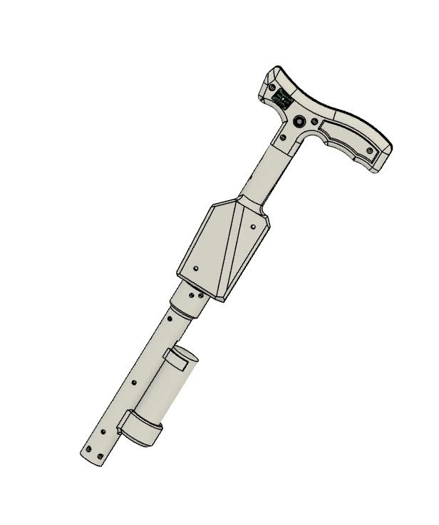](images/shc.jpg) [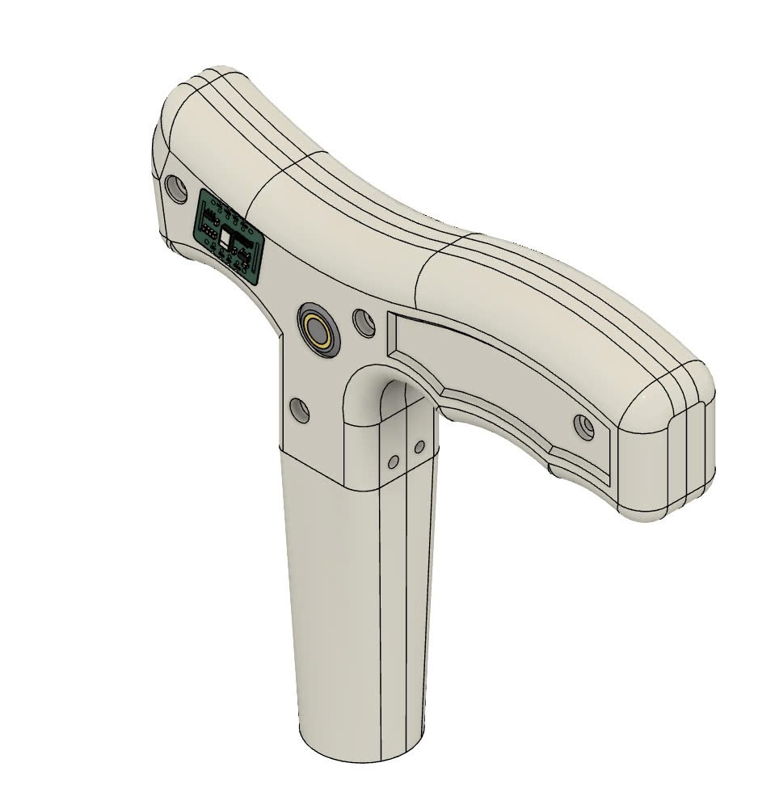](images/design_handle.jpg)

*3D design*

## Hardware

| Component | Function |
|---|---|
| Yolo:UNO | Main controller |
| MAX30102 | Heart rate and blood oxygen sensing |
| MPU6050 | Fall detection via Z-axis accelerometer deviation |
| AI Camera Kit V2 (OhStem) | Runs a Google Teachable Machine model for signage and crosswalk-marking recognition |
| LED strip (along the cane body) | Shows the AI camera result by color |
| Buzzer module | Audio alerts (3.3-5 V, about 2.5 kHz) |
| Sound Player module | Plays recorded alert clips |
| E-Ra IoT Platform (WiFi) | Receives live heart rate and X/Y/Z accelerometer data for a web dashboard and mobile app, and sends push notifications to a caregiver's phone through alert rules set on the platform |

## System architecture

Sensors and the camera feed the Yolo:UNO board as input. The board drives the on-cane alerts and streams data to the IoT platform as output.

```
INPUT                                          OUTPUT
-----                                          ------
MAX30102 (heart rate)          +-------------+  LED strip (AI result)
MPU6050 (fall detection)  ---> |  Yolo:UNO   |> Buzzer + Sound Player
AI Camera Kit V2               |    board    |> E-Ra IoT Platform (data stream)
                               +-------------+
```

E-Ra then sends push notifications to the caregiver's phone using alert rules I set up on the platform (see Live monitoring and alerts).

## Key design decisions

Every loop cycle runs two independent paths. The AI camera path recognizes signage and road markings and sets the LED strip color. The ALERT path first calls CHECK to assign a PRIORITY, then dispatches the on-cane alert based on it. Two timed tasks run in parallel to stream data to E-Ra: the accelerometer X/Y/Z every second and the rounded heart rate every 2 seconds.

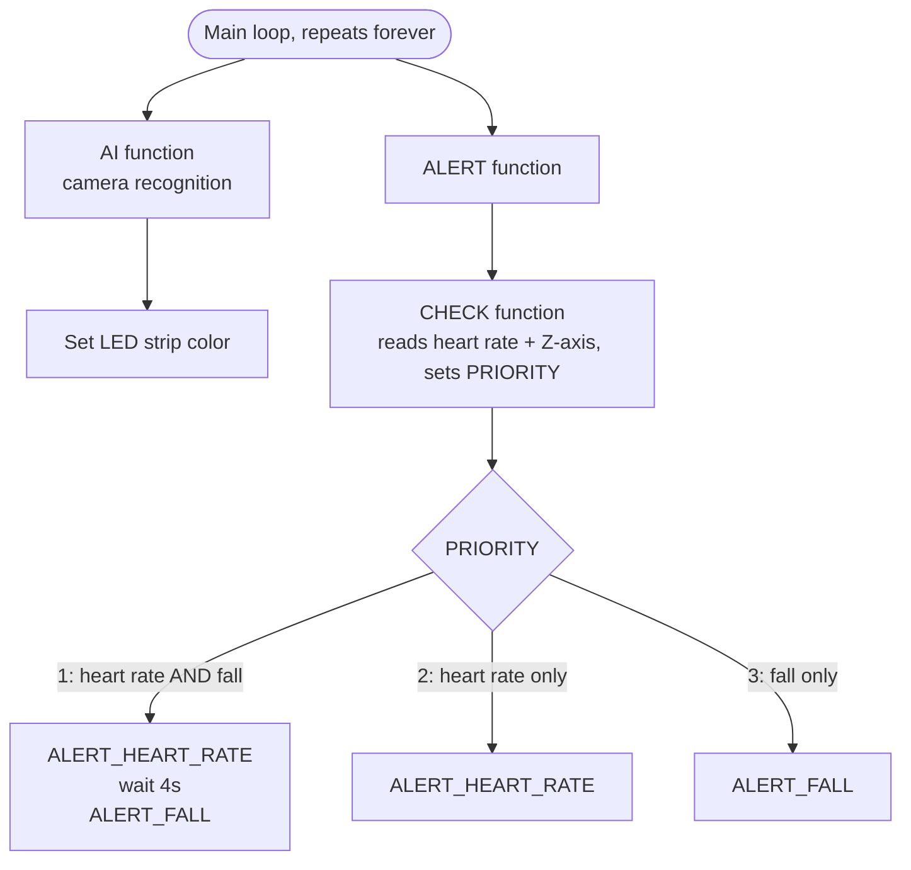

### Handling simultaneous events: the PRIORITY variable

Several events can happen at once, such as an abnormal heart rate and a fall. Rather than letting alerts overwrite each other, a `PRIORITY` variable ranks which condition fires first: an abnormal heart rate **and** a fall together (highest), then heart rate alone, then a fall alone.

## How it was built

I programmed it in the **OhStem App**, a block-based (drag-and-drop) visual programming environment for the Yolo:UNO board, similar to Scratch or Blockly. The logic (sensor setup, priority ranking, alert dispatch, AI camera response) was assembled block by block instead of typed as text code. At startup, the MPU6050 is calibrated with 500 samples and the absolute value of the current Z reading is stored as the baseline (`Z_baseline` in the pseudocode below).

> The screenshots of the block program below show the program logic, because the block editor does not export a text file. The block labels are in Vietnamese. The pseudocode sections are a readable translation of those blocks, not the literal source. Wi-Fi and cloud credentials are hidden.

[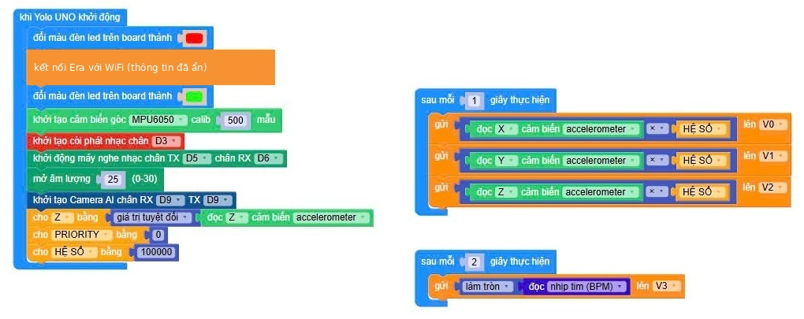](images/setup_blocks.jpg)

*Startup (MPU6050 calibration, sensors, camera) and the timed tasks that send accelerometer and heart-rate data to E-Ra*

### AI training

I sorted images into 3 labeled folders (one per recognition class) and trained a model with **Google Teachable Machine**, a no-code AI training tool. The classes are `signage`, `road_markings`, and `exception` (everything else). The model runs on the AI Camera Kit and classifies what the camera sees in real time.

[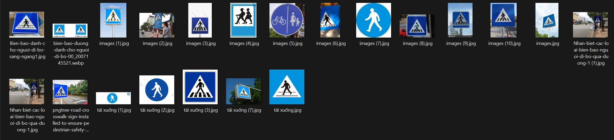](images/ai_dataset.jpg) [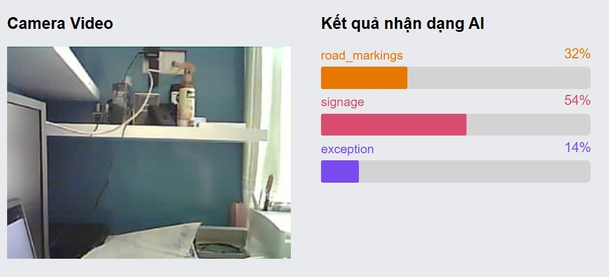](images/ai_result.jpg)

*Training images for one class, and a live classification result from the camera's web page. Here no class reaches the 70% confidence threshold, so the LED would show purple.*

### AI recognition function

[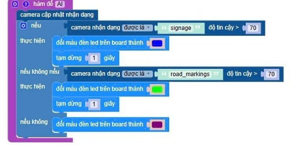](images/block_ai.jpg)

*AI: classifies the camera input as signage or road markings and sets the LED strip color. These blocks come from the earlier version that used the board's LED. The later version drives the LED strip.*

```
function AI():
    camera.update_recognition()
    if camera.detected == "signage" AND confidence > 70:
        set_LED_strip(BLUE)
        wait(1 second)
    elif camera.detected == "road_markings" AND confidence > 70:
        set_LED_strip(GREEN)
        wait(1 second)
    else:
        set_LED_strip(PURPLE)
```

The LED strip shows only the AI result (blue for signage, green for road markings, purple when nothing is recognized). Heart-rate and fall alerts use the speaker, not the LED.

### Priority assignment and alert dispatch

[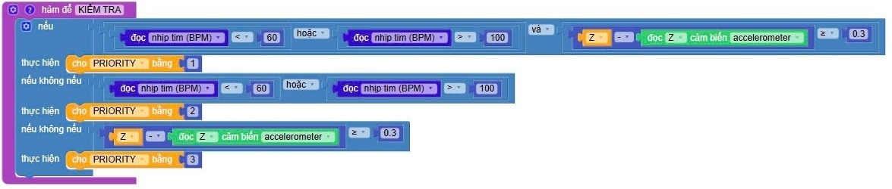](images/block_check.jpg)

*KIỂM TRA (CHECK): assigns PRIORITY based on which sensor conditions are true*

[](images/block_alert.jpg)

*CẢNH BÁO (ALERT): dispatches the alert based on PRIORITY*

```
function ALERT():
    CHECK()
    if PRIORITY == 1:
        alert_heart_rate()
        wait(4 seconds)
        alert_fall()
    elif PRIORITY == 2:
        alert_heart_rate()
    elif PRIORITY == 3:
        alert_fall()

function CHECK():
    if (heart_rate < 60 OR heart_rate > 100) AND (Z_baseline - Z_now) >= 0.3:
        PRIORITY = 1   # both conditions, most critical
    elif heart_rate < 60 OR heart_rate > 100:
        PRIORITY = 2   # abnormal heart rate only
    elif (Z_baseline - Z_now) >= 0.3:
        PRIORITY = 3   # fall only
```

### Heart-rate and fall alert functions

[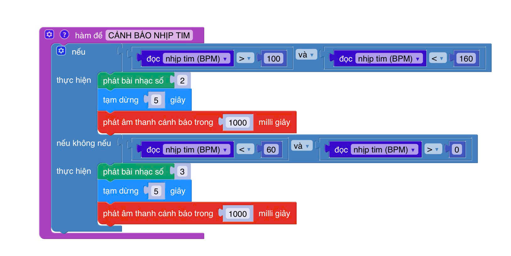](images/block_heart.jpg)

*CẢNH BÁO NHỊP TIM (heart-rate alert)*

[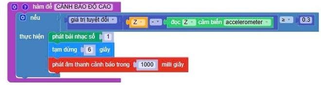](images/block_fall.jpg)

*CẢNH BÁO ĐỘ CAO (fall alert, based on the Z-axis change)*

```
function ALERT_HEART_RATE():
    if 100 < heart_rate < 160:
        play_sound(track=2); wait(5s); play_alert_tone(1000ms)
    elif 0 < heart_rate < 60:
        play_sound(track=3); wait(5s); play_alert_tone(1000ms)

function ALERT_FALL():
    if abs(Z_baseline - Z_now) >= 0.3:
        play_sound(track=1); wait(6s); play_alert_tone(1000ms)
```

The Sound Player tracks are: 1 for a fall, 2 for a high heart rate, 3 for a low heart rate. On the cane itself, a fall triggers only the speaker.

### Heart-rate range and why it has a ceiling

The on-cane heart-rate alert handles readings above 100 and below 160 BPM (high) and above 0 and below 60 BPM (low). A reading of 0 means the MAX30102 has no signal, for example when no finger is on the sensor, so the alert ignores it.

Readings of 160 BPM or above are also ignored. When I researched heart rates in elderly people, they did not normally go above 160, so I treated higher readings as unlikely to be real. The limitation is that a real tachycardia above 160 BPM would not trigger an alert.

## Live monitoring and alerts

The cane streams accelerometer X/Y/Z data (every second) and heart rate (every 2 seconds) to the E-Ra IoT dashboard.

[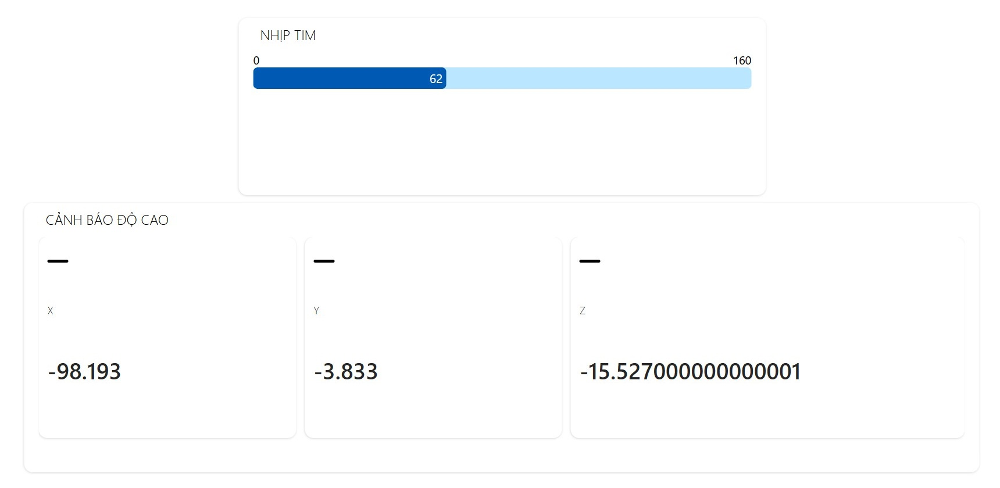](images/dashboard.jpg)

*E-Ra dashboard: live heart rate and accelerometer (X/Y/Z) readout*

The push notifications on the caregiver's phone are not sent by the cane's block program. They come from alert rules I set up on E-Ra. These rules only allow a simple "above" or "below" threshold on a streamed value, so they cannot run the baseline-difference check that the cane uses for falls. I set the thresholds by testing: heart rate below 60, and MPU6050 Z below 10, a value I measured when the cane fell. Each rule sends a single notification. The speaker alerts on the cane itself use the full logic described above and are separate from the phone alerts.

[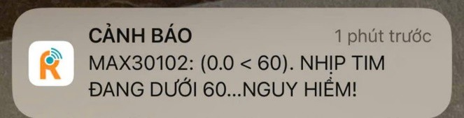](images/alert_heart.jpg) [](images/alert_fall.jpg)

*Alerts on the caregiver's phone from E-Ra rules. The first fired on a heart-rate reading of 0.0 (no pulse signal), and the second on a Z value below 10 (possible fall).*

## Status and limitations

SHC is a competition prototype. It is not a medical device, and its heart-rate readings are not medical-grade. The E-Ra trial account used during the competition is no longer active, so the dashboard and phone screenshots are from that period.

The fall logic is a single accelerometer threshold on the Z axis, so a dropped cane can raise a false alarm even when the user has not fallen (see Future development).

The phone alerts are a simplified version of the cane's logic. The fall threshold was set from the Z value measured during a test fall, so it depends on how the cane is held. The heart-rate rule also fires when the sensor reads 0.0 (no pulse signal), which the on-cane alert ignores. Each E-Ra rule notifies once.

In CHECK, a heart-rate reading of 0 counts as below 60, so PRIORITY can be set to 1 even though the heart-rate alert ignores 0. Each alert function checks its own condition again, so no false sound is played. The 4-second pause in the PRIORITY = 1 branch still runs, though, so a fall alert can be delayed by 4 seconds. PRIORITY is also never reset to 0, so after it is set to 1, that pause can repeat on every loop cycle until a different condition changes it.

Heart-rate readings of 160 BPM or above are ignored by the on-cane alert, as explained above.

The signage and crosswalk recognition is still in progress and not yet reliable enough for real-world use.

## Future development

A judge at the competition asked what happens if the cane drops but the user does not. This exposed a false-alarm risk in relying on a single fall-detection event. The planned fix is a two-step verification: a physical confirm button on the cane after a possible fall is detected, with an automatic caregiver alert if no confirmation arrives within a set time.

The cane already computes PRIORITY on the board. Streaming it to E-Ra as its own value would let a simple threshold rule use the same logic as the on-cane alert, instead of a raw Z threshold.

For the heart-rate logic, I would raise an alert when a reading of 160 BPM or above lasts for several seconds in a row, since a sustained high reading is more likely real than a sensor spike. Another option is to ask the user to reposition their hand and measure again before deciding.

Other planned improvements are a lighter, more ergonomic casing for daily use, and replacing the current Teachable Machine model with a more robust embedded computer vision model for wider real-world reliability.
