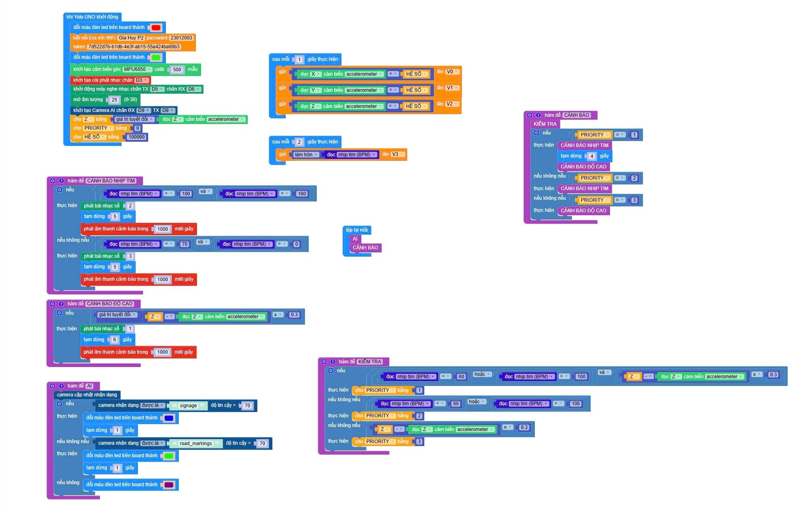

# Smart Health Cane (SHC)

A walking cane that detects falls, monitors heart rate, and recognizes signage, and alerts a caregiver's phone in real time.

## At a glance

| | |
|---|---|
| **What it is** | A prototype smart walking cane for elderly people who spend much of the day alone. |
| **What it does** | Detects a fall with an accelerometer and measures heart rate with a pulse sensor. It plays a recorded alert clip and a tone on the cane, and sends a push notification to a caregiver's phone through an IoT dashboard. A camera also recognizes pedestrian signage and crosswalk markings and shows the result on an LED strip. |
| **Built with** | Yolo:UNO (ATmega328P), MAX30102, MPU6050, AI Camera Kit V2 running a Google Teachable Machine model, and the E-Ra IoT Platform. Programmed with blocks in the OhStem App. |
| **My role** | Sole developer and main coder: sensor integration, priority logic, AI camera integration, and IoT alert dispatch. Concept design hand-sketched. |
| **Result** | Third Prize (Embedded Systems), Can Tho City-level Science and Engineering Competition, 2024-2025 (certificate dated 19 January 2025). |
| **Status** | Competition prototype, not a medical device. |

I designed this cane with my grandparents in mind. They spend most days alone at home while the rest of the family is at work, at school, or in the fields. The cane watches for falls and abnormal heart rate and sends an alert to a caregiver's phone. A camera also recognizes signage and road markings to help the user.

[](images/shc.jpg) [](images/design_handle.jpg)

*3D design*

## Hardware

| Component | Function |
|---|---|
| Yolo:UNO (ATmega328P, Arduino Uno-compatible) | Main controller |
| MAX30102 | Heart rate and blood oxygen sensing |
| MPU6050 | Fall detection via Z-axis accelerometer deviation |
| AI Camera Kit V2 (OhStem) | Runs a Google Teachable Machine model for signage and crosswalk-marking recognition |
| LED strip (along the cane body) | Shows the AI camera result by color |
| Buzzer module | Audio alerts (3.3-5 V, about 2.5 kHz) |
| Sound Player module | Plays recorded alert clips |
| E-Ra IoT Platform (WiFi) | Streams live heart rate and X/Y/Z accelerometer data to a web dashboard and mobile app, and pushes fall and heart-rate alerts to a caregiver's phone in real time |

## System architecture

Sensors and the camera feed the Yolo:UNO board as input. The board drives the alerts and the IoT link as output.

```
INPUT                                          OUTPUT
-----                                          ------
MAX30102 (heart rate)          +-------------+  LED strip (AI result)
MPU6050 (fall detection)  ---> |  Yolo:UNO   |> Buzzer + Sound Player
AI Camera Kit V2               |    board    |> E-Ra IoT Platform
                               +-------------+    (caregiver phone alert)
```

## Key design decisions

Every loop cycle runs two independent paths. The AI camera path recognizes signage and road markings and sets the LED strip color. The ALERT path first calls CHECK to assign a PRIORITY, then dispatches the alert based on it.


### Handling simultaneous events: the PRIORITY variable

Several events can happen at once, such as an abnormal heart rate and a fall. Rather than letting alerts overwrite each other, a `PRIORITY` variable ranks which condition fires first: an abnormal heart rate **and** a fall together (highest), then heart rate alone, then a fall alone.

## How it was built

I programmed it in the **OhStem App**, a block-based (drag-and-drop) visual programming environment for the Yolo:UNO board, similar to Scratch or Blockly. The logic (sensor setup, priority ranking, alert dispatch, AI camera response) was assembled block by block instead of typed as text code.

> The screenshots of the block program below are the actual source, because the block editor does not export a text file. The pseudocode sections are a readable translation of those blocks, not the literal source.

[](images/priority_blocks.jpg)

### AI training

I sorted images into 3 labeled folders (one per recognition class) and trained a model with **Google Teachable Machine**, a no-code AI training tool. The model runs on the AI Camera Kit and classifies what the camera sees in real time (crosswalk markings versus pedestrian signage).

[](images/ai_dataset.jpg) [](images/ai_result.jpg)

*Training data (one labeled folder per class) and the live classification result on the device*

### AI recognition function

[](images/block_ai.jpg)

*AI: classifies the camera input as signage or road markings and sets the LED strip color*

```
function AI():
    camera.update_recognition()
    if camera.detected == "signage" AND confidence > 70:
        set_LED(D10, BLUE)
        wait(1 second)
    elif camera.detected == "road_markings" AND confidence > 70:
        set_LED(D10, GREEN)
        wait(1 second)
    else:
        set_LED(D10, PURPLE)
```

The LED strip shows only the AI result (blue for signage, green for road markings, purple when nothing is recognized). Heart-rate and fall alerts use the speaker, not the LED.

### Priority assignment and alert dispatch

[](images/block_check.jpg)

*KIỂM TRA (CHECK): assigns PRIORITY based on which sensor conditions are true*

[](images/block_alert.jpg)

*CẢNH BÁO (ALERT): dispatches the alert based on PRIORITY*

```
function ALERT():
    CHECK()
    if PRIORITY == 1:
        alert_heart_rate()
        wait(4 seconds)
        alert_fall()
    elif PRIORITY == 2:
        alert_heart_rate()
    elif PRIORITY == 3:
        alert_fall()

function CHECK():
    if (heart_rate < 60 OR heart_rate > 100) AND abs(Z_baseline - Z_now) >= 0.3:
        PRIORITY = 1   # both conditions, most critical
    elif heart_rate < 60 OR heart_rate > 100:
        PRIORITY = 2   # abnormal heart rate only
    elif abs(Z_baseline - Z_now) >= 0.3:
        PRIORITY = 3   # fall only
```

### Heart-rate and fall alert functions

[](images/block_heart.jpg)

*CẢNH BÁO NHỊP TIM (heart-rate alert)*

[](images/block_fall.jpg)

*CẢNH BÁO ĐỘ CAO (fall alert, based on the Z-axis change)*

```
function ALERT_HEART_RATE():
    if 100 < heart_rate < 160:
        play_sound(track=2); wait(5s); play_alert_tone(1000ms)
    elif 0 < heart_rate < 60:
        play_sound(track=3); wait(5s); play_alert_tone(1000ms)

function ALERT_FALL():
    if abs(Z_baseline - Z_now) >= 0.3:
        play_sound(track=1); wait(6s); play_alert_tone(1000ms)
```

The Sound Player tracks are: 1 for a fall, 2 for a high heart rate, 3 for a low heart rate. A fall triggers only the speaker.

### Heart-rate range and why it has a ceiling

The heart-rate alert only handles readings from 100 to 160 BPM (high) and from above 0 to below 60 BPM (low). A reading of 0 means the MAX30102 has no signal, for example when no finger is on the sensor, so it is ignored.

Readings of 160 BPM or above are also ignored. I treat them as invalid because a pulse sensor on a handheld cane picks up motion, and movement can make the reading spike far above a real heart rate. The limitation is that a real tachycardia above 160 BPM would not trigger an alert.

## Live monitoring and alerts

Heart rate and fall-detection data stream to the E-Ra IoT dashboard in real time. When a fall or an abnormal heart rate is confirmed, a push notification goes directly to the caregiver's phone.

[](images/dashboard.jpg)

*E-Ra dashboard: live heart rate and accelerometer (X/Y/Z) readout*

[](images/alert_heart.jpg) [](images/alert_fall.jpg)

*Real alerts on the caregiver's phone: abnormal heart rate (left) and fall detected (right)*

## Status and limitations

SHC is a competition prototype. It is not a medical device, and its heart-rate readings are not medical-grade. The fall logic is a single accelerometer threshold on the Z axis, so a dropped cane can raise a false alarm even when the user has not fallen (see Future development). Heart-rate readings of 160 BPM or above are ignored, as explained above.

## Future development

A judge at the competition asked what happens if the cane drops but the user does not. This exposed a false-alarm risk in relying on a single fall-detection event. The planned fix is a two-step verification: a physical confirm button on the cane after a possible fall is detected, with an automatic caregiver alert if no confirmation arrives within a set time.

For the heart-rate logic, I would raise an alert when a reading of 160 BPM or above lasts for several seconds in a row, since a sustained high reading is more likely real than a motion spike. Another option is to ask the user to reposition their hand and measure again before deciding.

Other planned improvements are a lighter, more ergonomic casing for daily use, and replacing the current Teachable Machine model with a more robust embedded computer vision model for wider real-world reliability.
